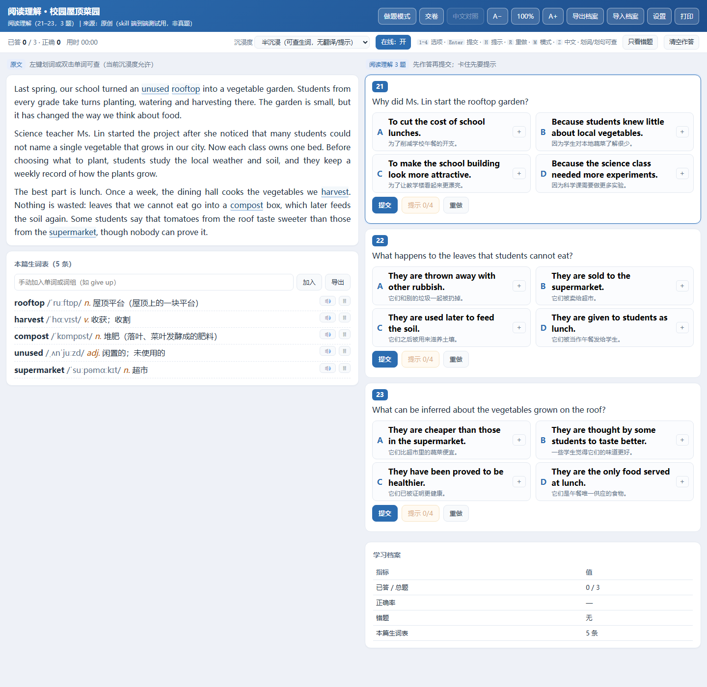

# 高考英语自学课件 Skill（gaokao-english-courseware）

把一份高考英语卷子变成**单文件、零依赖、双击就能打开**的学生自学课件：作答判分、四级提示、全量划词查词、逐句中英对照、学习档案、打印。

> 这是一个 Agent Skill（`SKILL.md` + 脚本 + 模板），不是在线服务：无需服务器、无需联网、产出的课件是一个 `.html` 文件。



---

## 1. 项目解决什么问题

市面上的英语讲解课件基本都是**教师揭示式**：一打开就是"答案 + 解析"全摊开，学生没法先自己动脑；查生词要另开词典来回切；做完不知道自己错在哪、哪些考点反复错；想把纸质卷数字化，又不想为此上一个后台系统。

这个项目把这些做成**一条可复现的生产线**：

| 痛点 | 它怎么做 |
|---|---|
| 学生一打开就看到答案 | **做题模式**：无答案、无翻译，答完才判分；卡住可逐级要提示（4 级，取用留痕） |
| 查生词要切词典 App | **原文每个词都能点**：音标 / 词性 / 语境义 / 原型 / 例句 / 全文出现次数 / 所在句译文；划一句给句子译文与结构 |
| 做完没有记录 | **学习档案**：作答、错题、生词本、考点掌握度存本地，可导出成 JSON 带走 |
| 题目散落在 Word / PPT / 截图里 | **一份 JSON 是唯一真源**，HTML 随时可重生成，学习记录不会被覆盖 |
| 手工排版容易漏（段落粘连、词表缺词、发旧版） | **6 道门禁**一条命令跑完，红了一样不能交付 |

**它不解决的问题**：听力播放、写作批改与读后续写、班级管理后台、多人在线、云端同步（档案在浏览器里，靠导出/导入迁移）。

---

## 2. 主要功能

### 2.1 四类题型

| 题型 | `meta.type` | 卷面位置 | 课件结构 |
|---|---|---|---|
| 阅读理解 | `reading` | 21–35 | 全文 + 3–4 道四选一（2.5 分/题） |
| 七选五 | `seven` | 36–40 | 原文留 5 空 + A–G 选项池（点空再点字母，2.5 分/题） |
| 完形填空 | `cloze` | 41–55（老卷 41–60） | 15 空 × 四选项（1 分/题） |
| 语法填空 | `grammar` | 56–65（老卷 61–70） | 10 空，填词与提示词（1.5 分/题） |

### 2.2 学生端（打开 HTML 就能用）

- **双模式**：做题模式 / 分析模式（快捷键 `M`）。
- **三档沉浸度**（做题模式的辅助强度）：讲解态（可看翻译与提示）· 半沉浸（默认，只可查生词）· 全沉浸（考试态，全关）。
- **作答与判分**：选项 / 填空 / 七选五点选；单题提交、整卷交卷；计时；`1-4` 选项、`Enter` 提交、`H` 提示、`R` 重做。
- **四级提示阶梯**：考点方向 → 定位证据 → 排除干扰项 → 答案 + 总结；用了几级会记录（`hintUsed` / `peeked`）。
- **划词卡**：音标、词性、语境义、原型（变形词）、例句、全篇复现次数、所在句 + 本句译文；一键跳有道 / 必应 / 剑桥，或走在线翻译。
- **划句卡**：句子译文 + 结构提示。
- **生词表**：数据自带的必背词在原文画蓝色实线，可手动加词、可导出 CSV、行内有朗读。
- **中文对照**：整篇逐段中英对照（讲解态 / 分析模式可用）。
- **深度解读**（阅读与七选五，仅分析模式）：文章结构、文化背景、长难句拆解。
- **交卷报告**：正确率、错题清单、**考点掌握度**表（按 `points.tag` 聚合，剔除"看过答案"的作答）。
- **学习档案**：作答进度、错题、生词本存在浏览器 `localStorage`（键 `enstudy:<docId>:progress`），可导出 `<docId>-progress.json`、换设备再导入。
- **打印**：做题模式打印空白卷，分析模式打印答案解析版（含 `@media print` 样式）。
- **在线开关**：联网查词/发音优先，失败自动降级为离线词表，不影响做题。

### 2.3 内容生产端（脚本，全部只用 Python 标准库）

| 脚本 | 作用 |
|---|---|
| `scripts/paths.py` | 解析工作区根：`ENSTUDY_ROOT` → 从 cwd 向上找 `04_workspace/schema-v1` → cwd |
| `scripts/init_workspace.py` | 空目录起手：建 `01_source/ 04_workspace/ 99_backups/` 并装入 schema v1.3 |
| `scripts/new_doc.py` | 生成 schema 合法的 TODO 数据骨架（四类题型各一套形状） |
| `scripts/schema_check.py` | 门禁 1：结构（零依赖 JSON Schema 子集校验器） |
| `scripts/validate.py` | 门禁 2：业务规则（题号区间、答案归属、hints 四级、七选五 A–G） |
| `scripts/coverage.py` | 门禁 3：词表覆盖率，`--missing` 列出缺哪些词 |
| `scripts/audit_samples.py` | 门禁 4：一致性（段落数=对照数、词索引、share 与 build 同哈希、覆盖率） |
| `scripts/build.py` | 门禁 5：JSON + 模板 → 单文件 HTML；`--share` 刷新交付副本 |
| `scripts/smoke_test.cjs` | 门禁 6：jsdom 真跑页面（约 110 条断言：判分、提示、划词、沉浸度、打印样式…） |
| `scripts/verify_all.py` | 一条命令串起上面 6 步（`--fast` 跳过冒烟、`--edge` 追加真机探针） |
| `scripts/apply_overlay.py` | 合并 `overlays/*.json`（词索引 / 选项注释 / 逐句译文 / 补词表） |
| `scripts/fix_wordindex.py` | 词索引大小写重名归并 |
| `scripts/selftest.py` | skill 自检 6 项（不依赖工作区） |
| `scripts/share_map.py` | 交付命名规则（登记名优先，未登记按标题自动命名） |
| `scripts/edge_probe.cjs` | 真实 Edge（CDP）探针：抓 JS 报错、看交互是否崩 |

### 2.4 能力边界（别对外承诺没有的）

| 有 | 没有 |
|---|---|
| 四类题型：reading / seven / cloze / grammar | 听力、短文改错、应用文、读后续写 |
| 学生版单文件课件 | 教师版批量揭示 / 投屏（`mode=teacher` 只是占位） |
| 七选五点空 + 点字母 | 七选五**拖拽** |
| 每篇独立 HTML、交卷报告、错题清单、生词本、考点掌握度 | 整卷合集视图（同一套卷多篇不合并统计） |
| 打印（空白卷 / 答案解析版） | 云端同步、班级后台、多人在线 |

---

## 3. 安装方法

### 3.1 前置

| 依赖 | 必需 | 说明 |
|---|---|---|
| Python 3.8+ | ✅ | 全部构建与门禁脚本，**只用标准库**（本项目在 Python 3.13 上验证） |
| Node.js 18+ 与 `jsdom` | 可选 | 冒烟测试要真跑页面；没有就跑 `verify_all.py --fast` |
| Edge / Chromium | 可选 | `--edge` 真机探针 |
| Agent 宿主 | 想"一句话让它做"才需要 | DSH / Claude Code / Codex，提供 skill 发现机制 |

### 3.2 放置

把 `gaokao-english-courseware/` 整个目录放到宿主的 skills 目录（目录名必须等于 `SKILL.md` 里的 `name`）：

| 宿主 | 位置 |
|---|---|
| DSH | `%USERPROFILE%\.dsh\skills\gaokao-english-courseware\`（项目内也可放 `<项目>/.dsh/skills/`） |
| Claude Code / Claude Desktop | `~/.claude/skills/gaokao-english-courseware/` |
| Codex | `~/.codex/skills/gaokao-english-courseware/`（`agents/openai.yaml` 提供 Codex 展示信息） |

Windows 上想保持"单一真源"（改源目录即生效）可以建 junction：

```powershell
New-Item -ItemType Junction -Path "$env:USERPROFILE\.dsh\skills\gaokao-english-courseware" `
         -Target "D:\你的目录\gaokao-english-courseware"
# macOS / Linux
ln -s /path/to/gaokao-english-courseware ~/.dsh/skills/gaokao-english-courseware
```

> DSH 里真正扫描磁盘的是 `@deepseek-ai/dsh-skill-filesystem`，它必须处于启用状态；否则目录放对也不会被发现。

### 3.3 验证安装

```powershell
# 1) skill 自检（不需要任何工作区）
python "~\.dsh\skills\gaokao-english-courseware\scripts\selftest.py"
#    6 项：必需文件 / frontmatter / 脚本语法 / 示例合 schema / 模板占位符 / 真构建

# 2) 让 Agent 加载：说一句"把这篇高考英语阅读做成学生课件"，能看到它读 SKILL.md 即安装成功
```

### 3.4 初始化一个卷子工作区

```powershell
python "~\.dsh\skills\gaokao-english-courseware\scripts\init_workspace.py" D:\卷子\2026模拟卷
```

生成：

```
D:\卷子\2026模拟卷\
├── 01_source\                       # 试卷照片 / PDF / docx 放这里（只读）
├── 04_workspace\
│   ├── schema-v1\
│   │   ├── schema.json              # 数据模型 v1.3（从 skill 的 assets/ 装入）
│   │   ├── examples\                # 内容 JSON（唯一真源）
│   │   └── overlays\                # 词索引 / 选项注释 / 逐句译文 / 补词表
│   ├── build\                       # 构建产物 + 门禁报告
│   └── share\                       # 交付副本（发给学生的）
└── 99_backups\                      # 快照（要回滚就整目录拷）
```

---

## 4. 使用方法

### 4.1 方式 A：让 Agent 做（推荐）

1. 把试卷照片 / PDF / docx 放进 `01_source/`；
2. 对 Agent 说：**"把 01_source 里的 A 篇做成课件，题号 21–23"**（也可以只给一段原文，让它原创一篇）。

Agent 会按 `SKILL.md` 的六步执行：抽原文 → 起骨架 → 补词表 → 合并 → 跑门禁 → 交付，产出 `04_workspace/share/<标题>.html`。

### 4.2 方式 B：自己跑流水线

> 工作区还没建的话，先跑 §3.4 的 `init_workspace.py`（建目录 + 装入 schema）。

```powershell
$py    = "python"
$skill = "$env:USERPROFILE\.dsh\skills\gaokao-english-courseware"
cd D:\卷子\2026模拟卷

# ① 起骨架（会打印"接下来填什么"）
& $py "$skill\scripts\new_doc.py" --doc-id reading-garden --type reading `
      --title "阅读理解 · 校园屋顶菜园" --nos 21-23 --partial --paper 新课标I卷

# ② 填 examples\reading-garden.json（字段见 references/schema.md，形状见 references/example-reading.json）
#    写完先单独验这一个：
& $py "$skill\scripts\validate.py" 04_workspace\schema-v1\examples\reading-garden.json

# ③ 补词表：先看缺什么，再写 overlays\reading-garden.fill.json
& $py "$skill\scripts\coverage.py" 04_workspace\schema-v1\examples\reading-garden.json --missing
& $py "$skill\scripts\apply_overlay.py" --all          # 合并（幂等；--check 只查不写）

# ④ 一条命令跑完 6 道门禁
& $py "$skill\scripts\verify_all.py"
```

门禁一览：

| 步骤 | 命令 | 通过标准 |
|---|---|---|
| 1 结构 | `schema_check.py --all` | 字段名 / 类型 / 枚举 / 未知字段全对 |
| 2 业务 | `validate.py --all` | 题号区间、答案在选项内、hints 四级连续、七选五 A–G |
| 3 词表 | `coverage.py --all` | 原文词表覆盖率 ≥ 95% |
| 4 一致性 | `audit_samples.py` | 段落数 = 对照数、share 与 build 同哈希、产物无占位符残留 |
| 5 构建 | `build.py --all --share` | 生成 HTML + 交付副本（同一输入两次 sha 一致） |
| 6 冒烟 | `smoke_test.cjs <html>` | 约 110 条页面断言全过 |

`verify_all.py --fast` 跳过第 6 步；`--edge` 追加真实 Edge 探针（慢，交付前建议跑一次）。

### 4.3 环境变量

| 变量 | 用途 |
|---|---|
| `ENSTUDY_ROOT` | 指定工作区根（不设就按 cwd 向上找 `04_workspace/schema-v1`） |
| `NODE_PATH` | 指向含 `jsdom` 的 `node_modules`（否则冒烟报 `Cannot find module 'jsdom'`） |
| `ENSTUDY_NODE` | 指定 node 可执行文件（PATH 里没有 node 时） |

### 4.4 常见问题

| 现象 | 原因 / 处理 |
|---|---|
| `Cannot find module 'jsdom'` | 设 `NODE_PATH`，或先用 `--fast` |
| 整篇原文粘成一段 | 新段首块漏了 `"br": true`；`audit` 会报"段落数 ≠ 对照段数" |
| 发出去的还是旧版 | 改了数据没跑 `build --all --share`；`audit` 判 ERROR |
| 题号区间报错 | `meta.paper` 写了不匹配卷型；不确定写 `待确认`，只做一节写 `meta.partial: true` |
| 词表覆盖率上不去 | `coverage.py <docId>.json --missing` 看缺哪些，写进 `overlays/<docId>.fill.json` |

更多坑见 `gaokao-english-courseware/references/pitfalls.md`（15 条，都真发生过）。

---

## 5. 输入 / 输出示例

### 5.1 输入

**素材**：试卷照片、PDF、docx、原件 HTML 都行——但**脚本只吃 JSON**，从原件到 JSON 的抽取由 Agent 或人完成（OCR 后的拼写、标点、答案来源都要核）。

**内容 JSON**（`04_workspace/schema-v1/examples/reading-garden.json`，真实字段节选；选项此处只列 A/B，实际每题 A–D 四项）：

```jsonc
{
  "schemaVersion": "1.3",
  "meta": {
    "docId": "reading-garden", "type": "reading", "mode": "student",
    "title": "阅读理解 · 校园屋顶菜园", "subtitle": "阅读理解（21–23，3 题）",
    "source": "原创（非真题）", "paper": "新课标I卷", "partial": true
  },
  "passage": {
    "blocks": [
      { "type": "p", "text": "Last spring, our school turned an unused rooftop into a vegetable garden.", "br": true },
      { "type": "p", "text": "Science teacher Ms. Lin started the project after she noticed ...", "br": true }
    ],
    "translation": ["去年春天，我们学校把一块闲置的屋顶变成了一片菜园。", "……"],
    "sentencePairs": [ { "id": "s1", "en": "Nothing is wasted: leaves that we cannot eat ...", "zh": "什么都不会浪费：……" } ],
    "wordIndex": {
      "rooftop": { "ipa": "/ˈruːftɒp/", "pos": "n.", "cn": "屋顶平台", "eg": "an unused rooftop 一块闲置的屋顶" },
      "leaves":  { "ipa": "/liːvz/", "pos": "n.", "cn": "叶子（leaf 的复数）", "base": "leaf" }
    },
    "structure": ["体裁：记叙兼说明（校园活动报道）……"],
    "culture": ["compost（堆肥）是把落叶、菜叶发酵后得到的肥料……"],
    "hardSentences": [ { "en": "Before choosing what to plant, ...", "zh": "……", "note": "Before choosing … 是介词+动名词作状语" } ]
  },
  "questions": [
    { "no": 21, "score": 2.5, "kind": "choice",
      "stem": "Why did Ms. Lin start the rooftop garden?",
      "options": [
        { "key": "A", "text": "To cut the cost of school lunches.", "distractorType": "无中生有", "why": "原文没有费用相关表述" },
        { "key": "B", "text": "Because students knew little about local vegetables." }
      ],
      "answer": "B",
      "points": [ { "tag": "细节理解/因果判断", "level": 2 } ],
      "hints": [
        { "level": 1, "type": "point",     "text": "细节题，先找 started the project…" },
        { "level": 2, "type": "evidence",  "text": "第 2 段首句：… after she noticed that …" },
        { "level": 3, "type": "eliminate", "text": "A 项费用、C 项美化，原文一字未提…" },
        { "level": 4, "type": "answer",    "text": "答案 B。定位第 2 段首句…" }
      ] }
  ],
  "glossary": [ { "key": "rooftop", "word": "rooftop", "ipa": "/ˈruːftɒp/", "pos": "n.", "cn": "屋顶平台" } ]
}
```

### 5.2 命令与真实输出

下面是一次真实运行的输出（该次 `docId` 为 `reading-demo`；换成你自己的 `docId` 即可）：

```text
> python scripts\build.py 04_workspace\schema-v1\examples\reading-demo.json --share
built reading-demo.html             114165 chars  sha=32646171078b
       -> share/阅读理解 · 校园屋顶菜园.html（按标题）

> python scripts\verify_all.py
==============================================================================
结构 schema_check        PASS schema=schema.json | 1 个文件，失败 0 个
业务 validate            PASS reading-demo.json   PASS errors=0 warnings=0 | report: 04_workspace/build/validate-report.md
词表覆盖率                PASS 最低 100.0%（阈值 95%）
一致性 audit              PASS reading-demo.html   OK   E=0 W=0 | report: 04_workspace/build/audit-report.md
构建 build --share       PASS -> share/阅读理解 · 校园屋顶菜园.html（按标题）
冒烟 smoke_test（1 份）    PASS 全部通过
==============================================================================
6 步，失败 0 步
```

### 5.3 输出

```
04_workspace\
├── build\
│   ├── reading-garden.html          # 单文件课件（110–180 KB，数据内联，file:// 双击可用）
│   ├── validate-report.md           # 业务校验报告
│   └── audit-report.md              # 一致性审计报告
└── share\
    └── 阅读理解 · 校园屋顶菜园.html   # 交付副本：这就是发给学生的文件
```

学生打开后看到的就是题首那张截图：左栏原文（生词实线、可划词划句）+ 本篇生词表，右栏题目卡片（作答 / 提示 / 重做）+ 学习档案；交卷后右栏出现交卷报告与考点掌握度，原文上方可切"分析模式"看结构、文化与长难句。

---

## 附：仓库结构

```
gaokao-english-courseware/          # ← Skill 本体（拷到宿主 skills 目录的就是这个目录）
├── SKILL.md                        # Agent 入口：何时用、六步、规范索引、坑、能力边界
├── agents/openai.yaml              # Codex 展示信息（可选）
├── references/                     # 按需加载：schema / pipeline / hints / distractors / tags / pitfalls / paper-spec + 2 份数据样例
├── templates/tpl-student.html      # 学生版模板（构建时注入数据）
├── assets/schema-v1.3.json         # 数据模型真源副本
├── scripts/                        # 14 个标准库脚本 + 2 个 node 测试脚本
└── docs/screenshot.png
```

## 许可

MIT，见 [LICENSE](LICENSE)。
